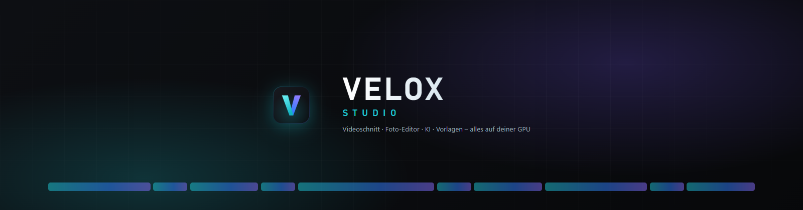
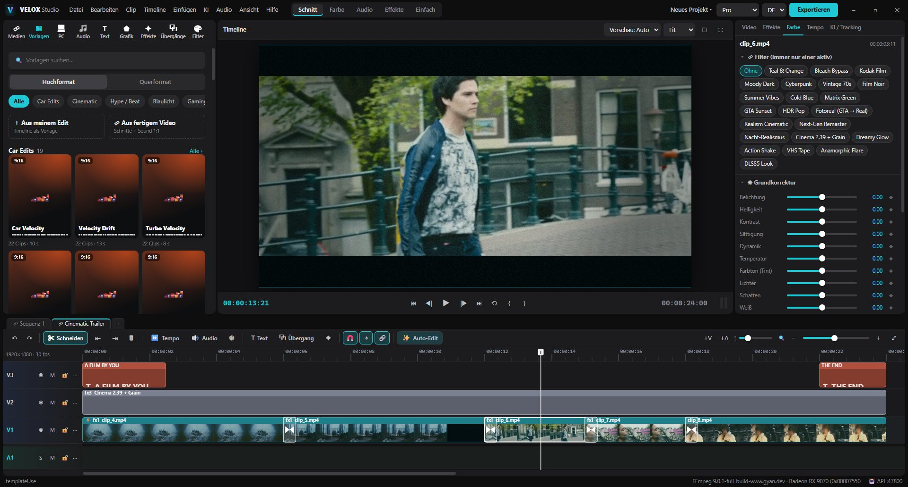
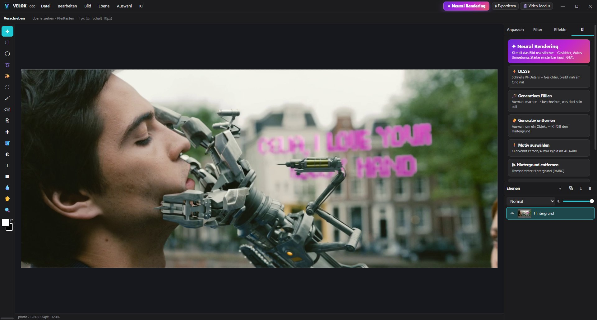
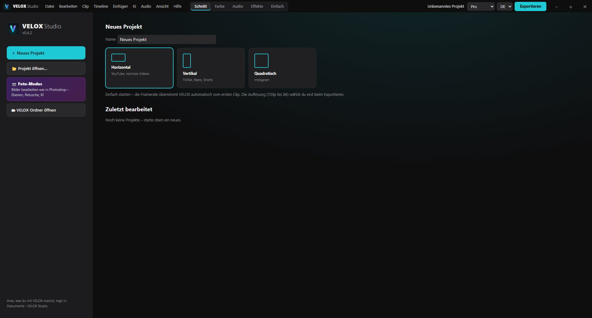
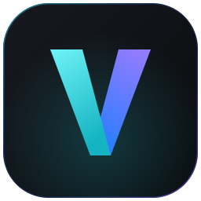

<p align="center">
  
</p>

<p align="center">
  <a href="../../releases/latest"></a>
  
  
  
</p>

<h3 align="center">Videoschnitt · Foto-Editor · KI · Vorlagen</h3>
<p align="center">Kostenlos. Schnell. Alles läuft lokal auf deiner Grafikkarte – <b>VELOX</b>.</p>

<p align="center"></p>

<p align="center">
  
</p>

<p align="center"></p>

## ⬇️ Download

1. Unter **[Releases](../../releases/latest)** die Datei `VELOX-Studio-Setup-x.y.z.exe` laden und starten.
2. Kommt *„Der Computer wurde durch Windows geschützt“*: **Weitere Informationen → Trotzdem ausführen** (die App ist nicht kostenpflichtig signiert).
3. Fertig – VELOX ist im Startmenü und auf dem Desktop. Updates installieren sich danach automatisch.

FFmpeg ist im Installer enthalten. KI-Modelle werden erst geladen, wenn du eine KI-Funktion zum ersten Mal benutzt.

<p align="center"></p>

## ✨ Was VELOX kann

| | |
|---|---|
| 🎬 **Schnitt** | Magnetische Timeline, Schneiden am Playhead, Snapping mit Einrast-Linie, Sequenzen, Multicam, Quell-Monitor, **Render-Cache** (grüner Balken = läuft flüssig, rendert in Pausen automatisch vor) |
| 🧩 **Vorlagen** | **Vorlagen Eigene** (nachgebaut aus echten Edits) + 177 TikTok-/Cinematic-Vorlagen (Car Edits, Blaulicht, Hype, Gaming/RP …) – **auch ein einziges langes Video reicht, die KI sucht die besten Stellen**. Eigene Vorlagen aus deinem Edit oder aus einem fertigen Video (Schnitte 1:1) |
| 🌀 **Übergänge** | **1100+** GPU-Übergänge, die die Clips verschmelzen – Länge frei einstellbar |
| 🎨 **Effekte & Farbe** | 185 Effekte, Filter/Looks, Farbräder, Kurven, LUTs, 3D-Ebenen mit Kamera, Keyframes & Graph-Editor |
| ⚡ **Tempo & Audio** | Velocity/Speed-Ramps, KI-Zeitlupe, Stimm-Effekte, Mixer, Beat-Erkennung, Soundeffekte-Bibliothek |
| 🧠 **KI (lokal)** | **Neural Rendering** (generativ realistischer, Stärke bis „GTA“), DLSS5, Hochskalieren, Gesichter, Hintergrund entfernen, Auto-Edit |
| 💬 **Animierte Untertitel** | Whisper hört zu, jedes Wort wird im Takt animiert – 10 TikTok-Stile (Pop, Box, Karaoke, Wort für Wort, Neon …), Stil jederzeit für alle änderbar |
| 🙈 **Zensur & Tracking-Maske** | KI findet und verfolgt **jedes Gesicht** automatisch → verpixeln, weichzeichnen oder Balken; Objekte (Kennzeichen, Logos) per Rahmen verfolgen; Maske „nur Bereich zeigen / ausschneiden“ |
| 📷 **Foto-Modus** | Ebenen, Auswahl, Pinsel, Stempel, Text, Filter + KI: generatives Füllen/Entfernen, Motiv auswählen |
| 📤 **Export** | 720p bis 8K, Hoch- oder Querformat, H.264/H.265/AV1/ProRes, GPU-Encoder |

<p align="center">
  
  
</p>

<p align="center"></p>

## 🛠️ Selbst bauen

```bash
npm install
npm start          # App starten
npm run dist       # Installer bauen (Ausgabe: dist/)
```

Für den Installer müssen `vendor/ffmpeg/ffmpeg.exe`, `ffprobe.exe` und `vendor/vcrt/*.dll` vorhanden sein (zu groß für Git) – der Release-Workflow lädt sie bei Bedarf automatisch.

**Neue Version veröffentlichen:** Version in `package.json` erhöhen, Installer lokal bauen und testen (`npm run dist`), dann mit `gh release create vX.Y.Z` den Setup, `.blockmap` und `latest.yml` aus `dist/` hochladen. Installierte Apps aktualisieren sich selbst. Notfalls baut GitHub den Installer auch selbst: *Actions → Release → Run workflow*.

<p align="center"></p>

## 📁 Wo liegt was?

- Projekte, Exporte, Fotos, Vorlagen: `Dokumente\VELOX Studio`
- Einstellungen, KI-Modelle, Logs: `%APPDATA%\velox-studio`
- Probleme? **Hilfe → Fehlerbericht erstellen** und die Datei vom Desktop schicken.

<sub>Bildmaterial in Screenshots und Vorlagen-Vorschaubildern: <a href="https://mango.blender.org">Tears of Steel</a> © Blender Foundation, Lizenz <a href="https://creativecommons.org/licenses/by/3.0/">CC BY 3.0</a>.</sub>

<p align="center"></p>

## 📄 Lizenz

VELOX Studio: **MIT** (siehe [LICENSE](LICENSE)).
Mitgeliefert: [FFmpeg](https://ffmpeg.org) als eigenständiges Programm (GPL v3). KI-Modelle haben eigene Lizenzen und werden erst bei Bedarf geladen (z. B. SD-Turbo: Stability AI Community License, nur nicht-kommerziell).

<p align="center"><br><sub><b>VELOX STUDIO</b> · made by VELOX</sub></p>
